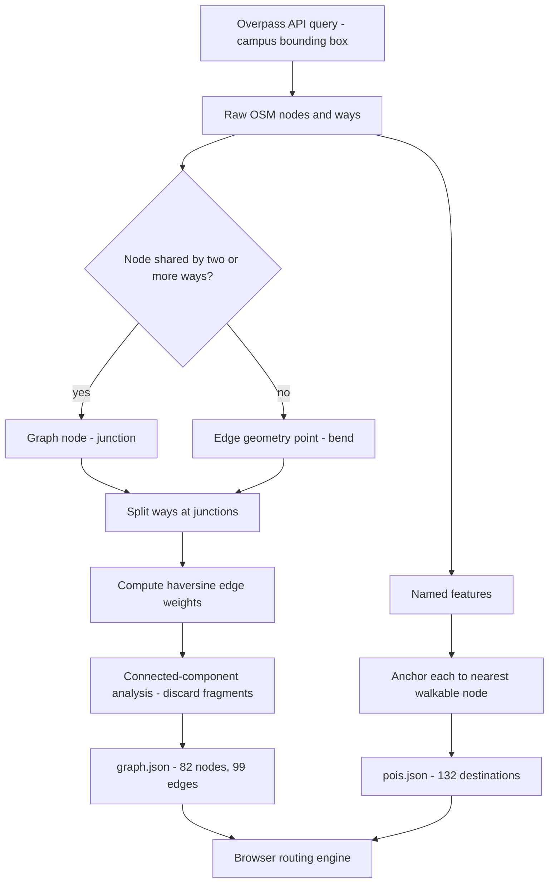
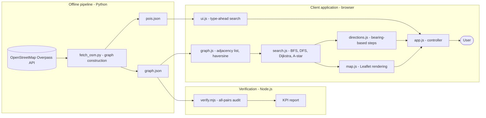

<div align="center">

A Mini Project Synopsis

On

# "WalchandOnGo: Campus Navigation Using Graph Algorithms and Heuristic AI Search"

Submitted to **Walchand College of Engineering, Sangli** for Partial Fulfilment of
the Third Year requirements under the **Apni Leap Initiative**, Department of
Artificial Intelligence and Machine Learning

<br>

**Submitted By**

| Name | PRN |
|---|---|
| Mr. / Ms. `<FILL IN>` | `<FILL IN>` |
| Mr. / Ms. `<FILL IN>` | `<FILL IN>` |
| Mr. / Ms. `<FILL IN>` | `<FILL IN>` |
| Mr. / Ms. `<FILL IN>` | `<FILL IN>` |

*(Groups G2, G6, G19)*

<br>

**Guided By**

Ms. A. B. Patil

<br>

**Department of Artificial Intelligence and Machine Learning**

**Walchand College of Engineering, Sangli**

Academic Year 2026 - 27

</div>

---

## Abstract

Locating a specific classroom, laboratory or faculty cabin on a large engineering
campus is a routine difficulty for first-year students, visitors and parents, and
existing consumer navigation applications stop at the campus gate. This project
presents **WalchandOnGo**, a web-based campus navigation system for Walchand
College of Engineering, Sangli, built on classical Artificial Intelligence search.

The campus is modelled as a weighted undirected graph derived from OpenStreetMap
data, in which junctions form nodes and walkable path segments form edges
weighted by true geodesic length. Four search strategies — Breadth-First Search,
Depth-First Search, Dijkstra's algorithm and A\* — are implemented over this
graph, with A\* guided by a haversine straight-line heuristic. The system
resolves 132 named campus destinations, computes an optimal walking route, and
renders turn-by-turn directions on an interactive map.

Rather than assuming the theoretical guarantees of these algorithms, the project
verifies them empirically across all 6,642 ordered node pairs in the graph. A\*
was found to return a route identical in cost to Dijkstra's on **100%** of pairs
while expanding **39.1% fewer nodes**, with **zero** admissibility violations
recorded. The result is a functioning navigation product together with a
reproducible experimental validation of informed search.

**Keywords:** *Campus Navigation, A\* Search, Dijkstra's Algorithm, Admissible
Heuristic, Informed Search, OpenStreetMap, Graph Traversal, Geospatial Routing*

---

## 1. Introduction

Wayfinding within a university campus is a well-defined instance of the shortest
path problem in a weighted graph. Although general-purpose navigation services
such as Google Maps and OsmAnd resolve routes between civic addresses with high
reliability, their utility terminates at the campus boundary; internal pedestrian
networks, department blocks, laboratories and individual classrooms are either
unmapped or unsearchable. Consequently a newcomer possesses no computational aid
precisely where the wayfinding difficulty is greatest.

Informed search provides the appropriate formalism for this problem. Following
the classical treatment of heuristic search [3], a search problem is defined by a
state space, a successor function, a step cost and a goal test. Mapping a campus
onto this formalism is direct: path junctions constitute states, adjacency along
a walkable segment constitutes the successor relation, and geodesic segment
length constitutes the step cost. The A\* algorithm [1] augments uniform-cost
search [2] with an admissible heuristic estimate of remaining cost, thereby
retaining the guarantee of optimality while reducing the number of states
expanded.

This project constructs such a system for Walchand College of Engineering,
Sangli, and — critically — treats the properties of the resulting search as
claims to be measured rather than asserted.

### 1.1 Motivation

- New students, visitors, parents and candidates attending examinations routinely
  fail to locate department blocks, laboratories and faculty cabins.
- Commercial navigation applications provide no intra-campus routing, and campus
  room-numbering schemes are not self-explanatory to a newcomer.
- The campus is already mapped in OpenStreetMap to an unusual level of detail,
  including individual classrooms, making a high-fidelity graph obtainable without
  a manual survey.
- Heuristic search is a core topic of the Artificial Intelligence curriculum, and
  a physical campus offers a setting in which its theoretical properties can be
  verified against real geospatial data.

### 1.2 Objective

- To construct a topologically correct weighted graph of the campus pedestrian
  network from OpenStreetMap data.
- To implement BFS, DFS, Dijkstra's algorithm and A\* over this graph with full
  instrumentation of nodes expanded, path cost and computation time.
- To verify empirically that the haversine heuristic is admissible and that A\*
  preserves optimality across the entire graph.
- To quantify the reduction in search effort achieved by A\* relative to
  Dijkstra's algorithm.
- To deliver a responsive web application providing search, route rendering,
  turn-by-turn directions and estimated walking time.
- To expose the internal behaviour of each algorithm visually, for pedagogical
  and evaluative purposes.

### 1.3 Problem Statement

 To design and implement a web-based campus navigation system that models
 Walchand College of Engineering, Sangli as a weighted undirected graph, computes
 the optimal walking route between any two of its named locations using informed
 and uninformed search strategies, and empirically validates the admissibility of
 its heuristic together with the optimality and search efficiency of A\* across
 all node pairs in the graph.

---

## 2. Related Work / Literature Survey

The shortest path problem in a non-negatively weighted graph was settled by
Dijkstra [2], whose algorithm settles vertices in non-decreasing order of distance
from the source and thereby guarantees optimality upon first settlement of the
goal. Its principal limitation is that it is uninformed: exploration proceeds
uniformly in all directions irrespective of the position of the goal.

Hart, Nilsson and Raphael [1] introduced A\*, which orders the frontier by
*f(n) = g(n) + h(n)*, where *g(n)* is the cost incurred and *h(n)* estimates the
cost remaining. They established that when *h* never overestimates true remaining
cost — the property of admissibility — A\* returns an optimal solution, and that
when *h* additionally satisfies the triangle inequality (consistency) no vertex
requires re-expansion. In geospatial routing the great-circle distance is a
natural admissible heuristic, since no walkable path between two points can be
shorter than the straight line separating them. This paper is adopted as the IEEE
base paper for the present work.

Russell and Norvig [3] situate these algorithms within the broader framework of
problem-solving agents and provide the standard analysis of completeness,
optimality and complexity for uninformed and informed search, which informs the
comparative methodology adopted here.

Subsequent research has pursued greater speed on continental road networks rather
than improved optimality. Goldberg and Harrelson [6] proposed the ALT scheme,
deriving sharper admissible heuristics from precomputed landmark distances via the
triangle inequality. Geisberger *et al.* [5] introduced Contraction Hierarchies,
which exploit an offline node-ordering phase to answer queries orders of magnitude
faster. Bast *et al.* [7] survey this field comprehensively. These techniques
target graphs of 10^6–10^8 nodes; at the scale of a single campus (10^2 nodes)
their preprocessing overhead is unjustified, and plain A\* with a geometric
heuristic remains the appropriate choice.

Haklay and Weber [4] characterise OpenStreetMap as a volunteered geographic
information system and document both its richness and its variable data quality —
an observation directly borne out during this project, as recorded in Section 8.3.

**Research gap.** The literature addresses either large-scale road routing or
theoretical guarantees in the abstract. Comparatively little published work
applies this apparatus at campus scale and *empirically verifies* admissibility
and optimality against a real surveyed network. This project addresses that gap.

---

## 3. Proposed Methodology / Algorithm / Approach

The system is organised as an offline data pipeline that produces a routing graph,
and an online client application that searches it.

### 3.1 Graph construction

Raw OpenStreetMap data is retrieved from the Overpass API for a bounding box
enclosing the campus. OSM represents roads as *ways*: ordered sequences of
coordinates containing a vertex wherever the road changes direction. A change of
direction is not, however, a decision point for a traveller. The pipeline
therefore classifies a coordinate as a graph node only where two or more ways
share it, or where it terminates a way; intermediate coordinates are retained as
edge *geometry*. This yields a compact graph whose nodes correspond to genuine
route decisions, while the rendered route still follows the true curvature of each
path.

Edge weight is the summation of haversine distances over all intermediate
coordinates of the segment, not the straight-line distance between its endpoints,
so that curved paths are not systematically undercosted.

Named campus features (buildings, rooms, laboratories, amenities) are polygons
adjacent to, but not part of, the path network. Since a search algorithm cannot
originate at a polygon, each feature is *anchored* to its nearest walkable node.
This anchoring constitutes the join between the destination catalogue and the
routable graph.



<div align="center"><b>Figure 3.1:</b> Data acquisition and graph construction pipeline</div>

### 3.2 Search strategies

Four strategies are implemented over a common interface returning the path, its
cost, the ordered list of expanded nodes and elapsed time.

| Algorithm | Frontier | Guarantee |
|---|---|---|
| BFS | FIFO queue | Fewest edges; **not** least distance |
| DFS | LIFO stack | Completeness only; no optimality |
| Dijkstra | Priority queue on *g(n)* | Least distance |
| A\* | Priority queue on *g(n) + h(n)* | Least distance, fewer expansions |

The heuristic is the haversine great-circle distance from the current node to the
goal. Since no walkable path may be shorter than the great-circle separation of
its endpoints, *h(n) ≤ h\*(n)* holds for every node, establishing admissibility by
construction. Section 5 reports the empirical verification of this property.

### 3.3 Direction generation

A node path is converted into natural-language instructions by computing the
compass bearing of the geometry entering and leaving each junction. The signed
angular difference is classified as continue (< 20°), bear (20–60°), turn
(60–150°) or sharp turn (> 150°). Consecutive segments sharing a road name and
exhibiting no turn are merged into a single instruction, preventing the
enumeration of every minor bend as a separate step.

---

## 4. Key Performance Indicators (KPIs)

Each indicator below is *falsifiable*: it is computed from measurement and is
capable of failing.

| # | KPI | Target | Measured | Status |
|---|---|---|---|---|
| 1 | Graph connectivity | Single connected component | 1 component, 82/82 nodes | **Met** |
| 2 | Reachability | 0 unreachable ordered pairs | 0 of 6,642 | **Met** |
| 3 | Heuristic admissibility | 0 violations over all pairs | 0 violations | **Met** |
| 4 | A\* optimality | Cost identical to Dijkstra on 100% of pairs | 100.00% | **Met** |
| 5 | Search efficiency | A\* expands no more than Dijkstra on every pair | 0 pairs worse; 39.1% fewer overall | **Met** |
| 6 | Query latency | Report p95 for the full graph | < 1.5 ms per query | **Met** |
| 7 | Destination coverage | At least 100 named campus locations | 132 | **Met** |
| 8 | Anchoring accuracy | Median anchor distance at most 50 m | 34 m median | **Met** |

**Note on baseline selection.** A comparison of A\* against BFS was deliberately
rejected. BFS disregards edge weights and therefore does not solve the same
problem; any reduction measured against it would be an artefact of the mismatch
rather than evidence of heuristic guidance. Dijkstra's algorithm solves exactly
the same problem as A\* and is the only defensible baseline.

---

## 5. Minimum Engineering Evidence

An automated verification harness (`tools/verify.mjs`) executes every algorithm
across all ordered node pairs and audits the properties claimed in Section 4.
Dijkstra's results serve as ground truth for optimality and admissibility.

```
graph: 82 nodes, 99 edges, 132 places
tested 6,642 node pairs

  PASS  connectivity: 0 unreachable pairs
  PASS  optimality: A* matches Dijkstra on 100.00% of pairs (0 mismatches)
  PASS  admissibility: 0 violations
  PASS  efficiency: A* expanded more than Dijkstra on 0 pairs

  A* explored 169,977 nodes total vs Dijkstra's 278,964
  -> 39.1% fewer, and strictly fewer on 97.91% of pairs
```

<div align="center"><b>Figure 5.1:</b> Output of the all-pairs verification harness</div>

**Representative query** — *Back Gate to Class Room 21*:

| Algorithm | Nodes expanded | Route length | Optimal |
|---|---|---|---|
| A\* | 3 | 159 m | Yes |
| Dijkstra | 7 | 159 m | Yes |
| BFS | 9 | 159 m | Not guaranteed |
| DFS | 18 | **728 m** | No |

DFS returns a route 4.58 times longer than optimal. This is not a defect but the
documented behaviour of depth-first search, and its inclusion demonstrates
concretely why informed search is required.

**Evidence summary**

1. A functioning web application resolving routes between 132 campus locations.
2. A reproducible pipeline regenerating the graph from OpenStreetMap.
3. Empirical confirmation of admissibility and optimality over 6,642 pairs.
4. A measured 39.1% reduction in search effort, obtained without loss of optimality.
5. Visualisation of expanded nodes, exposing algorithm behaviour directly.

---

## 6. Requirements Document

### 6.1 Functional requirements

| ID | Requirement |
|---|---|
| FR-1 | Search any of the 132 named campus destinations by partial or fuzzy text |
| FR-2 | Select origin and destination by search or by clicking the map |
| FR-3 | Compute and display the optimal walking route |
| FR-4 | Render the route following true path geometry |
| FR-5 | Display total distance and estimated walking time at 5 km/h |
| FR-6 | Generate turn-by-turn directions with road names and per-step distances |
| FR-7 | Permit selection among BFS, DFS, Dijkstra and A\* |
| FR-8 | Report nodes expanded, route cost and computation time per query |
| FR-9 | Visualise the set of nodes expanded during search |
| FR-10 | Compare all four algorithms on a single query |
| FR-11 | Indicate when a destination lies far from any mapped path |

### 6.2 Non-functional requirements

| ID | Requirement |
|---|---|
| NFR-1 | Query response under 50 ms (achieved: under 1.5 ms) |
| NFR-2 | Operation without a backend server; static hosting sufficient |
| NFR-3 | Responsive layout for mobile and desktop |
| NFR-4 | Graph regenerable from source data by a single command |
| NFR-5 | Minimal dependencies (`requests` for acquisition; Leaflet for rendering) |
| NFR-6 | Compliance with the ODbL licence through attribution of OpenStreetMap |

### 6.3 Constraints

- OpenStreetMap contains no `level` tags for this campus; floors are indistinguishable.
- Building interiors are unmapped; routing terminates at the nearest external path.
- Route quality is bounded by the completeness of volunteered OSM data.

---

## 7. System Architecture



<div align="center"><b>Figure 7.1:</b> System architecture</div>

The three tiers are deliberately decoupled. Data acquisition executes rarely and
offline; verification is a development-time audit; the client is a static bundle
requiring no server-side computation. Consequently the deployed application has no
runtime dependency on either Python or the Overpass API.

**Module responsibilities**

| Module | Responsibility |
|---|---|
| `tools/fetch_osm.py` | Overpass query, junction detection, edge weighting, POI anchoring |
| `tools/verify.mjs` | All-pairs correctness and efficiency audit |
| `web/js/graph.js` | Adjacency list, haversine, nearest-node lookup |
| `web/js/search.js` | Four instrumented search strategies |
| `web/js/directions.js` | Bearing-based turn-by-turn generation |
| `web/js/map.js` | Leaflet layers, route and expansion rendering |
| `web/js/ui.js` | Fuzzy destination search |
| `web/js/app.js` | Application controller |

---

## 8. Dataset & Feature Design

### 8.1 Dataset

The dataset is the OpenStreetMap extract for the campus, retrieved under the Open
Database Licence.

| Property | Value |
|---|---|
| Source | OpenStreetMap via Overpass API |
| Bounding box | 16.8415 – 16.8515 N, 74.5962 – 74.6068 E |
| Graph nodes (junctions) | 82 |
| Graph edges (segments) | 99 |
| Total walkable length | 10.24 km over 21 named roads |
| Named destinations | 132 |
| Connected components | 1 |

### 8.2 Feature design

| Entity | Feature | Type | Role |
|---|---|---|---|
| Node | `lat`, `lon` | Float | Position; heuristic input |
| Edge | `length_m` | Float | Edge weight (cost) |
| Edge | `geometry` | Coordinate list | True shape for rendering |
| Edge | `name`, `highway` | String | Direction generation |
| Edge | `step_free` | Boolean | Reserved for accessibility routing |
| POI | `name`, `kind` | String | Search and classification |
| POI | `nearest_node` | Node ID | Join to routable graph |
| POI | `anchor_dist_m` | Float | Confidence in the anchoring |

### 8.3 Data quality findings

Working with volunteered geographic data surfaced defects consistent with the
observations of Haklay and Weber [4]:

1. **Erroneous tagging.** Several classrooms and staff cabins carry
   `amenity=bank`; one building containing eight Civil Engineering rooms is tagged
   `amenity=toilets`. Category labels are therefore derived from feature names in
   preference to tags.
2. **Multi-valued name tags.** Eight Civil Engineering rooms were concatenated
   into a single semicolon-delimited `name`, rendering all eight unsearchable
   until programmatically separated.
3. **Bounding-box sensitivity.** An initial 700 m radius admitted several
   kilometres of Sangli city streets as a disjoint network, yielding six
   components. A tightened box with fragment removal yields a single component.
4. **Absence of vertical data.** No `level` tags exist, so floors cannot be
   distinguished from this source.

### 8.4 Proposed machine-learning extension

The system as delivered is founded on classical AI search and contains no learned
model. A natural extension, requiring **no manual data collection**, is to *learn
the heuristic function*.

The straight-line heuristic systematically underestimates walking distance, since
buildings must be circumvented. Training data may be generated from the graph
itself: exhaustive Dijkstra search over all pairs yields 6,642 labelled examples
at negligible computational cost.

| Aspect | Design |
|---|---|
| Input features | Δlat, Δlon, straight-line distance, node degrees, region indicators |
| Target | True shortest-path distance obtained from Dijkstra |
| Models | Linear regression, then gradient boosting, then multilayer perceptron |
| Validation | Hold out entire *nodes*, testing generalisation to unseen locations |
| Metrics | MAE against true distance; nodes expanded; proportion of routes optimal |

The trade-off is the substance of the experiment: a learned heuristic may
overestimate, forfeiting the guarantee of optimality. Sweeping a safety factor
applied to its predictions yields a measurable speed-versus-optimality curve. The
learned output feeds directly into A\* as its heuristic and is therefore integral
to the algorithm rather than appended to the system.

---

## 9. Conclusion

This project delivers a functioning campus navigation system for Walchand College
of Engineering, Sangli, founded on classical Artificial Intelligence search. A
topologically correct weighted graph of 82 junctions, 99 walkable segments and 132
named destinations was constructed from OpenStreetMap data, and four search
strategies were implemented over it.

The principal contribution is empirical rather than architectural. Across all
6,642 ordered node pairs, the haversine heuristic recorded **zero** admissibility
violations; A\* returned a route of cost identical to Dijkstra's on **100%** of
pairs; and A\* expanded **39.1% fewer nodes**, expanding strictly fewer on 97.91%
of pairs and never more on any. The theoretical guarantees of informed search are
thus confirmed against a real surveyed network rather than assumed.

The work further demonstrates that volunteered geographic information, while
sufficiently rich to support a production-quality routing product, carries
systematic defects that must be detected and corrected programmatically.

**Future work.** Correction of the identified tagging errors upstream in
OpenStreetMap; extension of the graph with internal corridors surveyed on foot;
accessibility-aware routing using the `step_free` attribute already carried by
every edge; and the learned-heuristic experiment specified in Section 8.4.

---

## 10. Software Details

### 10.1 Software specification

| Component | Technology |
|---|---|
| Data acquisition | Python 3.14, `requests` |
| Data source | OpenStreetMap Overpass API |
| Verification harness | Node.js 24 (ES modules) |
| Frontend | HTML5, CSS3, JavaScript (ES2022 modules) |
| Map rendering | Leaflet 1.9.4 |
| Tile provider | OpenStreetMap standard raster tiles |
| Backend | None — static client-side application |
| Version control | Git |
| Deployment | Any static host (e.g. GitHub Pages) |

### 10.2 Hardware requirements

| Role | Requirement |
|---|---|
| Development | Any system capable of running Python 3 and a modern browser |
| End user | Smartphone or desktop with a modern browser; GPS optional |
| Server | None |

### 10.3 Execution

```bash
python tools/fetch_osm.py                    # build graph from OpenStreetMap
node   tools/verify.mjs                      # run all-pairs verification
python -m http.server 8000 --directory web   # serve the application
```

The application is then available at `http://localhost:8000`.

---

## 11. Gantt Chart

| # | Activity | W1 | W2 | W3 | W4 | W5 | W6 | W7 | W8 | W9 | W10 | W11 | W12 | W13 | W14 |
|---|---|---|---|---|---|---|---|---|---|---|---|---|---|---|---|
| 1 | Problem definition and literature survey | X | X | | | | | | | | | | | | |
| 2 | Data source evaluation (GPX vs OSM) | | X | X | | | | | | | | | | | |
| 3 | Graph construction pipeline | | | X | X | | | | | | | | | | |
| 4 | Search algorithm implementation | | | | X | X | | | | | | | | | |
| 5 | Verification harness and KPI audit | | | | | X | X | | | | | | | | |
| 6 | Web application and map rendering | | | | | | X | X | X | | | | | | |
| 7 | Turn-by-turn direction generation | | | | | | | | X | X | | | | | |
| 8 | Corridor survey and OSM corrections | | | | | | | | | X | X | | | | |
| 9 | Accessibility (step-free) routing | | | | | | | | | | X | X | | | |
| 10 | Learned-heuristic experiment | | | | | | | | | | | X | X | | |
| 11 | Testing and external validation | | | | | | | | | | | | X | X | |
| 12 | Report writing and demonstration | | | | | | | | | | | | | X | X |

*Activities 1–7 are complete as of the date of this synopsis; activities 8–12 are planned.*

---

## References

[1] P. E. Hart, N. J. Nilsson, and B. Raphael, "A Formal Basis for the Heuristic
Determination of Minimum Cost Paths," *IEEE Transactions on Systems Science and
Cybernetics*, vol. SSC-4, no. 2, pp. 100–107, July 1968. **(Base paper)**

[2] E. W. Dijkstra, "A Note on Two Problems in Connexion with Graphs,"
*Numerische Mathematik*, vol. 1, no. 1, pp. 269–271, 1959.

[3] S. J. Russell and P. Norvig, *Artificial Intelligence: A Modern Approach*,
4th ed. Hoboken, NJ, USA: Pearson, 2020, ch. 3–4.

[4] M. Haklay and P. Weber, "OpenStreetMap: User-Generated Street Maps," *IEEE
Pervasive Computing*, vol. 7, no. 4, pp. 12–18, Oct.–Dec. 2008.

[5] R. Geisberger, P. Sanders, D. Schultes, and D. Delling, "Contraction
Hierarchies: Faster and Simpler Hierarchical Routing in Road Networks," in *Proc.
7th Int. Workshop on Experimental Algorithms (WEA)*, LNCS vol. 5038, Springer,
2008, pp. 319–333.

[6] A. V. Goldberg and C. Harrelson, "Computing the Shortest Path: A\* Search
Meets Graph Theory," in *Proc. 16th Annual ACM-SIAM Symposium on Discrete
Algorithms (SODA)*, 2005, pp. 156–165.

[7] H. Bast, D. Delling, A. Goldberg, M. Müller-Hannemann, T. Pajor, P. Sanders,
D. Wagner, and R. F. Werneck, "Route Planning in Transportation Networks," in
*Algorithm Engineering*, LNCS vol. 9220, Springer, 2016, pp. 19–80.

---

<div align="center">

| | | |
|:---:|:---:|:---:|
| **Ms. A. B. Patil** | **Mr. G. S. Bhosale** | **Dr. V. N. Waghmare** |
| Guide | Project Coordinator | Head |

</div>
